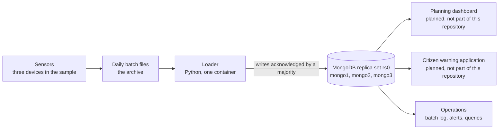

# citysense-batch

A batch oriented data system for municipal environmental sensor data. Sensor
readings are loaded in daily batches into a MongoDB replica set, implausible
readings are flagged, hourly and daily summaries and the latest value per
sensor are derived for a planning dashboard and a citizen warning
application, and alerts are raised without repeating themselves. The whole
system starts from a fresh clone with Docker as its only requirement.

This repository is the practical part of a portfolio for the IU course
DLBDSEDE02, Project: Data Engineering.

- Course: DLBDSEDE02, Project: Data Engineering
- Task: Task 1, choose a suitable database and store the data in batches
- Author: Mian Gohar Ehsan
- Matriculation number: IU14147184
- Tutor: Prof. Dr.-Ing. Paul Libbrecht

## Purpose

A municipality has installed environmental sensors, and the readings are meant to
feed two applications that do not exist yet: a dashboard that helps planners to
improve environmental conditions, and an application that warns citizens quickly
when values exceed recommended levels. The data system is the layer between the
sensors and those applications. It has an operational purpose, which is that
every statement made from the data can be traced to the readings it is based on,
and that missing, implausible or repeated data is noticed and not turned into an
all clear. A system without such a purpose could misinterpret, mistransport or
misconvert data without anyone noticing.

The sample data holds about 405,000 readings of three devices over one week in
July 2020. It is treated as the first part of a continuous feed and is replayed as
one batch per day, because the daily batch is the unit that can be retried when
anything fails. The concept is in `docs/concept.md`, and every decision, with the
alternatives that were rejected, is in `docs/decision-log.md`.

## Users and what each reads

| User | Question | Collections | Example |
| --- | --- | --- | --- |
| Urban planner | How do conditions develop per sensor over the day, and how do locations differ? | `summaries_hourly`, `summaries_daily` | hourly profile of a device with the number of readings and the coverage next to every mean |
| Citizen, through the warning application | Is the air in the district acceptable right now, and how current is that statement? | `latest`, `alerts` | latest valid value per sensor with its measurement time, and the alerts that are open |
| Data engineer | Did every batch arrive and load, how many readings were rejected, what is wrong and what has to be done? | `batch_runs`, `alerts`, `readings` | batch log with counts, flagged readings by rule, alerts about the loader |

A summary always carries the number of readings it is based on, because a mean of
a handful of readings must not look as trustworthy as a mean of several hundred.
The latest value always carries its measurement time, because a sensor that
stopped reporting has to appear as an old value and never as an all clear. The
queries in `scripts/queries.js` answer one question per user, and are shown in the
section on verification below.

## Where the system fits

In the repository, the sensors are represented by the compressed sample file in
`data/raw/`, which the loader reads as if it were the daily batch files of a feed.
The loader reads the file in order, cuts it into UTC days, flags the readings that
are implausible, stores every reading under an identifier that is built from the
device and the measurement time, derives the summaries and the latest values with
aggregation pipelines inside the database, and evaluates the alerts. Both front
ends only read the collections that are listed above, so a new front end needs no
change of the loader. The planning dashboard and the warning application are not
part of this repository and are stated as planned in the concept.

## Quick start

The only requirement is Docker with the Compose plugin. The system was tested with
Docker 29.9.3 and Compose 5.7.0 on an Apple silicon machine. Nothing else is
installed on the host, and no credentials, accounts or manual steps are needed.

    git clone <the address of this repository>
    cd citysense-batch
    docker compose up --build

The first start pulls the MongoDB, Python and uv images and builds the loader
image, which needs network access once. Compose then starts three MongoDB nodes, initiates the replica set,
creates the collections, validators and indexes, and starts the loader. The loader
reads 405,184 rows, stores 405,171 readings after it has recognised 13 rows as
repeated, flags 580 of them, and ends with the exit code 0. The load took between
19 and 22 seconds on the development machine. The command stays attached to the
three nodes, so the output of the loader is the last thing that it prints before it
exits:

    loader-1  | ... INFO finished: 9 batches loaded, 0 skipped, read 405184, inserted 405171, already present 13, flagged 580, duration 19.2 s

The state of the services can be checked from a second terminal:

    docker compose ps -a

The service `loader` must show `exited (0)`, and the services `mongo1`, `mongo2` and
`mongo3` must be healthy. Starting the same command again leaves the data as it is,
because the loader finds every batch completed and skips it. The data is kept in
the volumes `citysense_mongo1-data`, `citysense_mongo2-data` and
`citysense_mongo3-data`.

    docker compose down        # stops the stack and keeps the data
    docker compose down -v     # stops the stack and removes the data of this project

The command `down -v` removes only the volumes of this project.

## Verification

After the load, the database holds 405,171 readings, of which 580 are flagged, 579
hourly and 27 daily summaries, 3 latest values and 14 alerts. The integration tests
pin these figures. They can be seen directly with the shell of the database, which
runs inside the container, so that no database tool is needed on the host:

    docker compose exec mongo1 mongosh citysense --eval 'db.latest.find()'
    docker compose exec mongo1 mongosh citysense --eval 'db.alerts.find({}, {message: 1})'

The scripts in `scripts/` need Docker and a shell, and nothing else.

| Script | What it shows | Duration | Output |
| --- | --- | --- | --- |
| `scripts/demo_queries.sh` | One example query per user, and an engineer who acknowledges an open alert, which a later batch then resolves while the time of the acknowledgement is kept | about one minute | `docs/evidence/queries.txt` |
| `scripts/demo_crash_rerun.sh` | The loader is killed with SIGKILL in the middle of a batch, the next run repeats that batch, and every collection equals a load that was never interrupted | a few minutes | `docs/evidence/crash_rerun.txt` |
| `scripts/demo_failover.sh` | The primary of the replica set is killed during a batch, a new primary is elected after about 11 seconds, the loader goes on, and every collection equals an uninterrupted load | a few minutes | `docs/evidence/failover.txt` |

The queries of the file `scripts/queries.js` can also be run on their own, with
the commands in the header of that file. Each demonstration resets the stack of
this project, so it replaces the data of a running stack. The reasoning is in
ADR-0015.

## Configuration

The loader reads its settings from environment variables, and every setting has a
default. Compose sets the connection string. The other settings can be given to a
single run, for instance `docker compose run --rm -e MAX_BATCHES=3 loader`.

| Variable | Default | Meaning |
| --- | --- | --- |
| `MONGODB_URI` | the replica set, set by Compose | connection string of the loader |
| `DATABASE` | `citysense` | name of the database |
| `SOURCE_FILE` | `data/raw/iot_telemetry_data.csv.gz` | the source that is replayed as daily batches |
| `CHUNK_SIZE` | 5000 | readings per write |
| `MAX_BATCHES` | all | most batches that one run loads, to simulate the daily arrival of data |
| `ALERT_THRESHOLDS` | `config/alert_thresholds.toml` | file with the limits of the alerts |
| `RETENTION_DAYS` | 365 | days after which raw readings expire, counted from their ingestion, read by the setup service |

An invalid value stops the loader with the exit code 2 before it touches the
database. The limits of the alerts are in `config/alert_thresholds.toml`, which
Compose mounts into the loader read only, so that a limit can be changed on the
host without building the image again. Every entry of the file states its basis.
A changed limit applies to the evaluations that follow, and the alerts that are
stored are not rewritten (ADR-0014).

## Tests

The system itself needs only Docker. The tests are for development and need
Python 3.13 with uv, which installs the environment from `uv.lock`.

    uv run pytest tests/unit               # pure rules, no Docker needed
    uv run pytest -m integration           # needs the compose stack running
    uv run ruff check .
    uv run ruff format --check .

The unit tests cover the rules without a database. The integration tests run
against the stack and check what a user of the data would see: counts, the
agreement of the summaries with the raw readings, repeated runs that change
nothing, and the alerts of the sample week. They take about eight minutes.

A workflow in `.github/workflows/ci.yml` runs the lint and the unit tests on every push,
and then the integration tests on a freshly started stack (ADR-0016).

## Project structure

    docker-compose.yml       three MongoDB nodes, the setup service and the loader
    Dockerfile               the loader image, two stages
    config/                  limits of the alerts, mounted into the loader
    data/raw/                the sample data, gzip compressed, with its licence in data/README.md
    db/                      replica set initiation and database setup scripts
    src/citysense/
        config.py            settings from environment variables and the limits file
        identity.py          deterministic document identifiers, pure
        validation.py        plausibility rules, pure
        batches.py           reading the source and slicing it into daily batches, pure
        alert_rules.py       alert conditions, deduplication, hysteresis, cap, pure
        store.py             reads and writes of the readings and the batch log
        aggregation.py       pipelines of the summaries and the latest values
        alerting.py          reads and writes of the alerts
        loader.py            batch orchestration, batch log, retries
        __main__.py          entry point of the container
    scripts/                 demonstrations, verification queries, data profile
    tests/unit/              rules and orchestration, no database
    tests/integration/       against the running stack
    .github/workflows/       continuous integration
    docs/                    concept, requirements, decision log, journal, evidence

The modules that hold rules do not import the database driver, so they are tested
without a database. The requirements and the code that satisfies each of them are
traced in `docs/requirements.md`.

## Data source

The sample data is the environmental sensor telemetry published by Stafford, G.
(2020), Environmental sensor telemetry data, Kaggle,
https://www.kaggle.com/datasets/garystafford/environmental-sensor-data-132k. It is
published under the Creative Commons CC0 1.0 Universal public domain dedication,
so it may be redistributed with the repository. The columns, their units as the
source states them, the checksums and the open questions about the units are in
`data/README.md`.

## Limits

The prototype is limited in ways that are stated here and argued in the decision
log.

The three nodes of the replica set run on one machine, so the system survives the
loss of a node or of the primary, which `scripts/demo_failover.sh` shows, but not
the loss of the machine. Sharding is not part of the prototype. The replica set can
become a shard of a sharded cluster, with the device and the time as the shard key,
when the number of sensors requires it.

The database runs without authentication, because a key would have to be committed
or generated by a manual step, and a fresh clone has to start with one command and
without credentials. The published port is bound to the loopback interface of the
host, so it is not reachable from the network. A production setup would enable
authentication and transport encryption (ADR-0009).

MongoDB 5.0 and later require a processor with the AVX instruction set on x86
machines, so the nodes of the official image, version 8.0.38, are not expected to
start on an x86 machine without it. The image is published for several
architectures and runs on Apple silicon, which is the platform where the system was
tested. It was not tested on x86.

Alerts are only as current as the batch interval, so an application that shows them
has to show the time of the last batch with every statement. A batch is taken as
complete once it is loaded and is then skipped, so a day that arrives in two parts
cannot be extended. The last day of the sample ends at 00:03, so it is partial, and
the rules judge only hours that are complete, which keeps that partial hour from
making every sensor look silent.

The limits of the alerts are operating limits chosen from the measured distribution
of one week of three sensors. No recommended value could be applied, because the
source does not explain the unit "ppm (%)" of the three gas columns and states the
temperature in Fahrenheit although the values are consistent with Celsius, and the
placement of the sensors, indoors or outdoors, is not known. The limits are meant to
be replaced by official values once units and placement are known. A sensor that
never delivers anything has no baseline and is not detected as silent, and the
coverage detects outages and not a slow degradation of a sensor, because the
baseline of a device is the median of its own earlier hours (ADR-0013 and
ADR-0014).

The retry schedule of the loader, which waits 2, 4, 8, 16 and 30 seconds, is tested
with injected errors. In the demonstration of the loss of the primary, the driver
waited for the election and repeated the write by itself, so the schedule of the
loader was not needed, which ADR-0015 explains.

## Documentation

| File | Content |
| --- | --- |
| `docs/concept.md` | the technical concept that the implementation follows |
| `docs/requirements.md` | every requirement traced to the code and the tests that satisfy it |
| `docs/decision-log.md` | the architecture decisions with their rejected alternatives |
| `docs/dev-journal.md` | the chronological record of the work, with the problems |
| `docs/backlog.md` | the work items with their scope |
| `docs/evidence/` | the captured output of the demonstrations |
